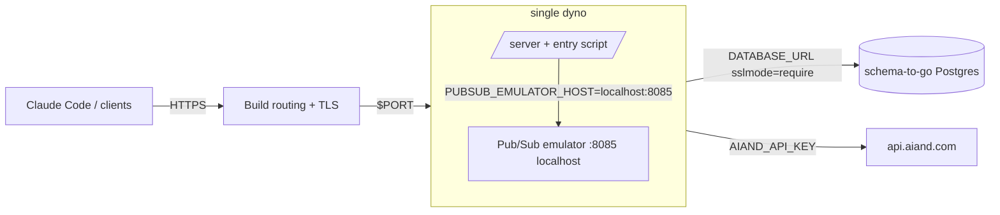

# Deploying to build.io (single-dyno production runbook)

This runbook deploys the router as a managed production grid on
[build.io](https://www.build.io) from a `dockerfile` stack. It covers the
target shape validated for 10–15 users: one `performance-m` web dyno, an
embedded Pub/Sub emulator, and a `schema-to-go` Postgres addon.

The full environment-variable surface is documented in
[docs/CONFIGURATION.md](CONFIGURATION.md); this page only sets the variables
a build.io deployment needs.

## Table of contents

- [Prerequisites](#prerequisites)
- [Architecture](#architecture)
- [Provisioning](#provisioning)
- [Deploy](#deploy)
- [Post-deploy verification](#post-deploy-verification)
- [Scaling guidance](#scaling-guidance)
- [Rollback](#rollback)

## Prerequisites

- **`bld` CLI** installed and logged in to your build.io account/team:

  ```bash
  bld login
  bld whoami   # confirm the account/team you intend to deploy into
  ```

- **Git checkout of the branch you want to ship** (the app deploys via
  `git push`; no GitHub intermediary is required).
- **Upstream credentials ready as values, not files**: `AIAND_API_KEY` and
  `AIAND_BASE_URL` (the ai& endpoint the router dispatches to).
- **A fresh Tink AES-256-GCM keyset JSON** for
  `EXTERNAL_KEY_ENCRYPTION_KEY` (BYOK encryption, see
  [docs/CONFIGURATION.md](CONFIGURATION.md#byok-encryption)). Generate it
  locally and keep it out of the repo; it is applied with `bld config:set`
  in the provisioning step only.
- **Dockerfile stack requirement**: the ORT/ONNX CGO toolchain cannot run
  under Heroku-style buildpacks, so the app must use the `dockerfile`
  stack (set below during provisioning).

## Architecture



Key properties:

- **Single dyno, single replica.** The Pub/Sub emulator runs on localhost
  *inside* the web dyno (started by the image entry script), so cache
  invalidation only ever needs to reach one replica. This is correct for
  one web dyno and becomes a limitation exactly when you scale out (see
  [Scaling guidance](#scaling-guidance)).
- **Migrations at boot.** The dockerfile stack has no release phase, so the
  entry script runs `migrate` against `DATABASE_URL` (idempotent, safe on
  restart) before `exec`-ing the server.
- **Ports.** The router listens on `$PORT` (default 8080); Build routes
  external HTTPS traffic to it. Procfile is not used under the dockerfile
  stack — the image CMD/ENTRYPOINT governs.
- **Dashboard** is served at `/ui/` (selfhosted mode) and gated by
  `ROUTER_ADMIN_PASSWORD`.

## Provisioning

Create the app, switch stacks, attach the database, and set config vars.
Secret placeholders below (`<...>`) must be replaced with real values at the
prompt — never commit them to the repo.

```bash
# 1. Create the app
bld apps:create aiand-router

# 2. Use the dockerfile stack (buildpacks cannot run the ONNX toolchain)
bld stacks:set dockerfile

# 3. Attach Postgres: schema-to-go, basic plan (10 GiB storage / 2 GiB RAM, $9/mo)
bld addons:create schema-to-go:basic

# 4. Set config vars
bld config:set \
  ROUTER_DEPLOYMENT_MODE=selfhosted \
  ROUTER_ADMIN_PASSWORD=<ROUTER_ADMIN_PASSWORD> \
  EXTERNAL_KEY_ENCRYPTION_KEY=<TINK_AES_256_GCM_KEYSET_JSON> \
  AIAND_API_KEY=<AIAND_API_KEY> \
  AIAND_BASE_URL=<AIAND_BASE_URL> \
  PUBSUB_PROJECT_ID=router-build \
  PUBSUB_TOPIC_ROUTER_INVALIDATION=router-installation-invalidate \
  PUBSUB_SUBSCRIPTION_ROUTER_INVALIDATION=router-installation-invalidate \
  ROUTER_CLUSTER_VERSION=v1.2 \
  ROUTER_STARTUP_EGRESS_ORIGINS=api.aiand.com \
  LOG_FORMAT=json \
  LOG_LEVEL=info
```

Notes:

- `DATABASE_URL` is injected automatically by the schema-to-go addon; the
  entry script appends the `router` schema search path and pre-creates the
  schema (managed addon databases may not allow `CREATE DATABASE` but do
  allow `CREATE SCHEMA`). You do not set `DATABASE_URL` by hand.
- `PORT` is injected by Build; the server already reads it. Do not set it.
- `PUBSUB_EMULATOR_HOST`, `ROUTER_ONNX_ASSETS_DIR` and
  `ROUTER_ONNX_LIBRARY_DIR` are set inside the dyno by the entry script —
  leave them out of config vars.
- OpenTelemetry vars are intentionally unset (OTLP disabled). To enable
  later, see [docs/CONFIGURATION.md](CONFIGURATION.md#telemetry-opentelemetry).
- `ROUTER_STARTUP_EGRESS_ORIGINS` lists `api.aiand.com` only: with the
  embedded emulator, Pub/Sub traffic stays on localhost.

## Deploy

Deploy via git push directly to Build's git host (no GitHub step needed):

```bash
# Get the git remote for the app
bld apps:info aiand-router
# then, from your checkout of the branch you want to ship (e.g. v0):
git remote add build <git-remote-from-apps-info>
git push build v0:main
```

Watch the build logs until the push goes green:

```bash
bld builds --app aiand-router
bld logs --app aiand-router --tail
```

## Post-deploy verification

Check the dyno is up, then hit the health endpoints and dashboard:

```bash
# Liveness, readiness, and startup probes
curl -sS -o /dev/null -w '%{http_code}\n' https://<app-hostname>/livez
curl -sS -o /dev/null -w '%{http_code}\n' https://<app-hostname>/readyz
curl -sS -o /dev/null -w '%{http_code}\n' https://<app-hostname>/startupz

# Version (should show the commit stamp you pushed)
curl -sS https://<app-hostname>/v1/version

# Dashboard (selfhosted mode; password-gated)
curl -sS -o /dev/null -w '%{http_code}\n' https://<app-hostname>/ui/

# Inference smoke test through the router
curl -sS https://<app-hostname>/v1/messages \
  -H "Authorization: Bearer <ROUTER_API_KEY>" \
  -H 'content-type: application/json' \
  -d '{"model":"claude-sonnet-4-5","max_tokens":256,
       "messages":[{"role":"user","content":"hi"}]}'
```

Also confirm in the logs that migrations ran at boot:

```bash
bld logs --app aiand-router | grep -i migrate
```

## Scaling guidance

The default deployment is honest-single-replica: the embedded Pub/Sub
emulator only serves the one dyno it lives in. Scale deliberately:

| Trigger | Action |
| --- | --- |
| Sustained load with p95 latency within budget | Stay on `schema-to-go:basic` ($9, 10 GiB/2 GiB). |
| p95 DB latency rising under load | Change the addon plan from the dashboard's add-on management page for the app (there is no `bld` command for plan changes): switch `schema-to-go` from `basic` to `standard-0` ($50/mo). If you instead destroy and re-create the addon, its connection strings rotate — update `DATABASE_URL` (and any derived config vars) with `bld config:set` before the next boot. |
| Need a 2nd web dyno | The localhost emulator cannot broadcast invalidation across replicas. Migrate to real GCP Pub/Sub: create a GCP project, topic and subscription, then set the `PUBSUB_*` env vars (project ID, topic, subscription, credentials) per [docs/CONFIGURATION.md](CONFIGURATION.md#server) and unset `PUBSUB_EMULATOR_HOST`. The upgrade is env-var-only; no code change. |
| Embedder CPU-bound | The ONNX Jina embedder runs in-process per routing decision and needs real CPU — keep `performance-m` (2.5 GB RAM, 100% dedicated CPU) or larger. Standard 512 MB dynos cannot hold server + emulator + embedder. |

## Rollback

build.io keeps previous deployments; rolling back means listing history and
either using the dashboard's one-click rollback or re-pushing the old commit
— the CLI has no command to deploy an old build:

```bash
# List recent builds/deployments for the app (deployments list marks the
# currently-running one with *)
bld builds --app aiand-router
bld deployments --app aiand-router
```

Then, from the dashboard:

- **Activity tab**: locate the previous successful build and click
  **"Rollback to here"**.
- **Deploy tab**: use **"Deploy Branch"** against the known-good branch or
  commit to build and run the same code.

Alternatively, re-push the known-good commit from your checkout
(`git push buildio <known-good-sha>:main` or similar), which triggers a fresh
build of the old code.

Config-var changes are part of rollback too: if a rollback pairs with a
downgrade (e.g. older `ROUTER_CLUSTER_VERSION`), restore the matching
values with `bld config:set`. Migrations are idempotent and additive; the
boot-time `migrate up` is safe across restarts and rollbacks.
