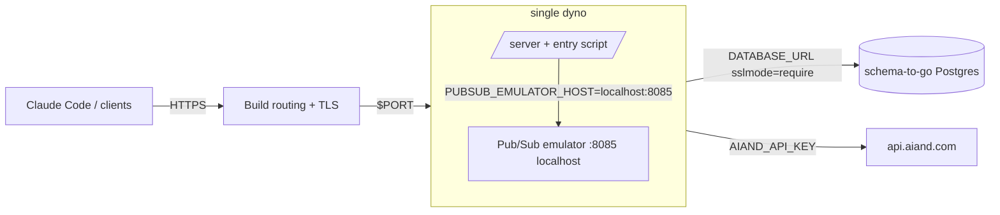

# Deploying to build.io (single-dyno production runbook)

This runbook deploys the router as a managed production grid on
[build.io](https://www.build.io) from a `dockerfile` stack. It covers the
target shape validated for 10–15 users: one `performance-m` web dyno, an
embedded Pub/Sub emulator, and a `schema-to-go` Postgres addon.

The full environment-variable surface is documented in
[docs/CONFIGURATION.md](CONFIGURATION.md); this page only sets the variables
a build.io deployment needs.

## Table of contents

- [Prerequisites](#prerequisites)
- [Architecture](#architecture)
- [Provisioning](#provisioning)
- [Deploy](#deploy)
- [Deploy verification](#deploy-verification)
- [Build once, deploy a prebuilt image](#build-once-deploy-a-prebuilt-image)
- [Build queue stuck (platform-side)](#build-queue-stuck-platform-side)
- [Post-deploy verification](#post-deploy-verification)
- [Scaling guidance](#scaling-guidance)
- [Rollback](#rollback)

## Prerequisites

- **`bld` CLI** installed and logged in to your build.io account/team:

  ```bash
  bld login
  bld whoami   # confirm the account/team you intend to deploy into
  ```

- **Git checkout of the branch you want to ship** (the app deploys via
  `git push`; no GitHub intermediary is required).
- **Upstream credentials ready as values, not files**: `AIAND_API_KEY` and
  `AIAND_BASE_URL` (the ai& endpoint the router dispatches to).
- **A fresh Tink AES-256-GCM keyset JSON** for
  `EXTERNAL_KEY_ENCRYPTION_KEY` (BYOK encryption, see
  [docs/CONFIGURATION.md](CONFIGURATION.md#byok-encryption)). Generate it
  locally and keep it out of the repo; it is applied with `bld config:set`
  in the provisioning step only.
- **Dockerfile stack requirement**: the ORT/ONNX CGO toolchain cannot run
  under Heroku-style buildpacks, so the app must use the `dockerfile`
  stack (set below during provisioning).

## Architecture



Key properties:

- **Single dyno, single replica.** The Pub/Sub emulator runs on localhost
  *inside* the web dyno (started by the image entry script), so cache
  invalidation only ever needs to reach one replica. This is correct for
  one web dyno and becomes a limitation exactly when you scale out (see
  [Scaling guidance](#scaling-guidance)).
- **Migrations at boot.** The dockerfile stack has no release phase, so the
  entry script runs `migrate` against `DATABASE_URL` (idempotent, safe on
  restart) before `exec`-ing the server.
- **Ports.** The router listens on `$PORT` (default 8080); Build routes
  external HTTPS traffic to it. Procfile is not used under the dockerfile
  stack — the image CMD/ENTRYPOINT governs.
- **Dashboard** is served at `/ui/` (selfhosted mode) and gated by ai&
  account login: device flow first (approve the code at ai&), or paste an
  existing Aiand `sk-` key at `/login?mode=paste`. The first login bootstraps
  a dedicated account + installation; no password or env var is required.

## Provisioning

Create the app, switch stacks, attach the database, and set config vars.
Secret placeholders below (`<...>`) must be replaced with real values at the
prompt — never commit them to the repo.

```bash
# 1. Create the app
bld apps:create aiand-router

# 2. Use the dockerfile stack (buildpacks cannot run the ONNX toolchain)
bld stacks:set dockerfile

# 3. Attach Postgres: schema-to-go, basic plan (10 GiB storage / 2 GiB RAM, $9/mo)
bld addons:create schema-to-go:basic

# 4. Set config vars
bld config:set \
  ROUTER_DEPLOYMENT_MODE=selfhosted \
  EXTERNAL_KEY_ENCRYPTION_KEY=<TINK_AES_256_GCM_KEYSET_JSON> \
  AIAND_API_KEY=<AIAND_API_KEY> \
  AIAND_BASE_URL=<AIAND_BASE_URL> \
  PUBSUB_PROJECT_ID=router-build \
  PUBSUB_TOPIC_ROUTER_INVALIDATION=router-installation-invalidate \
  PUBSUB_SUBSCRIPTION_ROUTER_INVALIDATION=router-installation-invalidate \
  ROUTER_CLUSTER_VERSION=v1.2 \
  ROUTER_STARTUP_EGRESS_ORIGINS=api.aiand.com \
  ROUTER_PLANNER_ENABLED=false \
  ROUTER_SCORE_TOOL_RESULT_TURNS=false \
  LOG_FORMAT=json \
  LOG_LEVEL=info
```

Notes:

- `DATABASE_URL` is injected automatically by the schema-to-go addon; the
  entry script appends the `router` schema search path and pre-creates the
  schema (managed addon databases may not allow `CREATE DATABASE` but do
  allow `CREATE SCHEMA`). You do not set `DATABASE_URL` by hand.
- `PORT` is injected by Build; the server already reads it. Do not set it.
- `PUBSUB_EMULATOR_HOST`, `ROUTER_ONNX_ASSETS_DIR` and
  `ROUTER_ONNX_LIBRARY_DIR` are set inside the dyno by the entry script —
  leave them out of config vars.
- OpenTelemetry vars are intentionally unset (OTLP disabled). To enable
  later, see [docs/CONFIGURATION.md](CONFIGURATION.md#telemetry-opentelemetry).
- `ROUTER_STARTUP_EGRESS_ORIGINS` lists `api.aiand.com` only: with the
  embedded emulator, Pub/Sub traffic stays on localhost.
- `ROUTER_PLANNER_ENABLED=false` + `ROUTER_SCORE_TOOL_RESULT_TURNS=false`
  (single-CPU dyno): pinned sessions reuse their decision without re-running
  the cluster scorer, and tool-result turns reuse the session pin verbatim —
  together with the boot embed warmup and soft/overall embed budget this cuts
  most per-turn embed work. Tradeoff: no EV-based mid-session model
  switching. See "Scaling guidance" below.

## Branch model and releases

Two long-lived branches, nothing else:

| Branch | Role | Deploys? |
| --- | --- | --- |
| `main` | Upstream mirror. Fetch/merge upstream commits here; it is never shipped. | No |
| `v0` | Product trunk and the only production source. | Yes, on every push |

Rules that keep it that way:

- **No long-lived version branches.** `v1.0`/`v0.1.0`-style branches rot the
  moment they fall behind `v0`; releases are immutable tags instead
  (`router-vX.Y.Z`, cut from a green `v0` commit).
- **Retired branch tips are kept as `archive/<branch>` tags.** Tags are
  immutable history; branches are not.
- **`main` and `v0` cannot be deleted or force-pushed** (repository ruleset
  `protect long-lived branches`). Admins can bypass for break-glass use.
- **`v0` requires the `Test` check on pull requests** (ruleset
  `v0 requires tests`).
- **Nothing ships untested.** A `v0` push runs the `Test` workflow, and
  build.io waits for that required check before it builds.
- **The release gate is the `Deploy verification` workflow**
  ([.github/workflows/deploy-verify.yml](../.github/workflows/deploy-verify.yml)):
  build.io auto-deploys `v0` in the direct model, or the generated `deploy`
  branch (digest-pinned prebuilt image) in the thin model. Deploy
  verification waits for the `Test` check, verifies the latest production
  release created after the run started, and probes the live health
  endpoints; `--sha` remains available for verifying a specific build. A
  failed verification fails the commit — it must not be mistaken for a
  repository failure; a red verification is frequently platform-side (see
  [Build queue stuck (platform-side)](#build-queue-stuck-platform-side)).

Upstream changes flow one way:

```bash
git switch main
git fetch <upstream-remote>          # upstream commits land on main
git merge --ff-only <upstream-remote>/main
git push origin main
# then port the commits you want onto v0 (branch, PR, merge); never merge
# main into v0 wholesale
```

## Deploy

`v0` is the deployment branch. `main` only carries upstream merges and is
never shipped, so nothing reaches production from `main`.

The app is connected to `fenilmodi00/aiand_router` in build.io and
auto-deploys branch `v0`, waiting for the required `Test` check before it
builds. A red `Test` leaves production untouched, and build.io records the
build and release on the repository's Deployments page itself.

Manual deploy, when the integration cannot run:

```bash
# Get the git remote for the app
bld apps:info aiand-router
# then, from your checkout of the branch you want to ship (e.g. v0):
git remote add build <git-remote-from-apps-info>
git push build v0:main
```

The host accepts `git-receive-pack` only; fetching from it (`git ls-remote`,
`git fetch`) returns 403 by design.

Watch the build logs until the push goes green:

```bash
bld builds --app aiand-router
bld logs --app aiand-router --tail
```

## Deploy verification

[.github/workflows/deploy-verify.yml](../.github/workflows/deploy-verify.yml)
is the release gate that runs after every `v0` push:

1. **Preflight.** It runs `docker build --check -f Dockerfile .` to lint the
   Dockerfile, and asserts the Dockerfile's last stage is `buildio-release`
   (the stage build.io actually ships).
2. **Wait for CI.** It waits for the required `Test` check on the commit.
3. **Verify the release.** It runs
   [scripts/verify_buildio_release.sh](../scripts/verify_buildio_release.sh)
   and probes the live health endpoints
   `https://<app-hostname>/{livez,readyz,startupz}`.

The verification works for both release models:

- **Direct `v0` build:** build.io deploys the pushed SHA, so the script
  verifies that SHA's `build-production` and `production` deployments.
- **Thin `deploy` branch (build once, see below):** build.io releases the
  generated image-pin commit, not the pushed SHA. By default the script runs
  `--latest --since-epoch <run start>`: it requires a `production` deployment
  **newer than the moment the run started** (recorded before the `Test` wait,
  so a release that lands while CI runs is still counted) and checks its
  health. A specific commit can still be checked at any time with
  `--sha <sha>` (also via `workflow_dispatch`'s `sha` input).

**First run after switching the app branch to `deploy`:** expect the gate to
be red until the thin build actually produces a production release — "no new
production deployment" is the intended signal that the pipeline has not
released yet, not a repository failure. It turns green as soon as the thin
build releases.

A red `Deploy verification` does not automatically mean the code is broken.
Read the workflow's `::error::` line first — it distinguishes these cases:

- **"no new production deployment since <time>"** (`--latest` mode) — build.io
  has not released anything since the run started; check the build queue.
- **"build.io never created a deployment"** — the GitHub integration or the
  build queue dropped the push; see the troubleshooting section below.
- **"build failed"** — build.io attempted the Docker build and it failed;
  check the build logs before touching the Dockerfile.
- **"build pending past the queue timeout"** — build.io's builder never
  started; this is platform-side (see below).

## Build once, deploy a prebuilt image

When build.io's builder itself is the failure point (pending builds that never
reach kaniko), stop asking it to compile. Build the image once on GitHub
Actions, store it in GHCR, and let build.io deploy that prebuilt artifact:

- [`.github/workflows/image.yml`](../.github/workflows/image.yml) runs on
  every `v0` push, waits for the required `Test` check on that commit, then
  builds the `buildio-release` target and pushes the image to
  `ghcr.io/fenilmodi00/aiand_router`, tagged with the commit SHA and `v0`.
  Pull requests build the image immediately as validation without pushing;
  only `v0` pushes wait for `Test` and then publish the digest and update
  the deploy branch.
- The workflow's `publish-deploy-branch` job then runs
  [scripts/deploy/update_buildio_deploy_branch.sh](../scripts/deploy/update_buildio_deploy_branch.sh),
  which republishes the `deploy` branch with a thin Dockerfile that is only
  `FROM ghcr.io/fenilmodi00/aiand_router@sha256:<digest>` — the exact image
  that just passed tests, pinned by digest. The branch also carries a no-op
  `Test` workflow so build.io's CI gate has a green check on the deploy
  branch; the real test gate runs on `v0` before the image is published.
- In the build.io dashboard, set the app's branch to `deploy` (one time).
  From then on each deploy pulls the digest-pinned image.

  Dashboard steps:

  1. Open the app's **Deploy** tab and find the GitHub connection /
     **Automatic Deploys** section.
  2. Select the `deploy` branch and save.
  3. If the pipeline pushes `deploy` with `GITHUB_TOKEN` (no
     `DEPLOY_BRANCH_TOKEN` secret), clear the **Wait for CI** option for this
     branch — the real `Test` gate already ran on `v0` before the image was
     published. Alternatively add `DEPLOY_BRANCH_TOKEN` so the no-op `Test`
     workflow runs on `deploy`.
  4. Use **Manual Deploy → Deploy Branch → `deploy`** for the first thin
     build. Later image-pin commits redeploy automatically.

build.io has no prebuilt-image deploy API: it still creates a build, but the
thin Dockerfile only removes compilation. If the account build quota is
exhausted, the thin build will also fail until support resets it.

**GHCR visibility:** the thin Dockerfile pulls from GHCR without
credentials, and a package pushed with `GITHUB_TOKEN` is private by
default. The image contains no secrets (config reaches the dyno via
config vars), so a public package is acceptable. The workflow attempts to
flip the package to public after each push; if the API call cannot change
visibility, set it manually under the package's *Package settings* on
GitHub, or configure build.io's builder with a GHCR read token — the thin
build fails with an image-pull auth error otherwise.

**CI gate on the deploy branch:** GitHub suppresses workflow runs for
pushes made with `GITHUB_TOKEN`, so the deploy branch's no-op `Test`
workflow does not run when the pipeline pushes with the default token.
Either add a repository secret `DEPLOY_BRANCH_TOKEN` (a fine-grained PAT
with `contents: write` and `workflow` permission on this repo — the
workflow already prefers it, so the push then triggers the no-op check),
or disable build.io's "wait for CI" gate for the `deploy` branch in the
dashboard. The real `Test` gate still runs on `v0` before the image is
published; the deploy-branch check exists only to satisfy build.io's
gate.

**Rollback:** point the app's branch back to `v0` in the dashboard (git-based
deploys of the old code), or rerun
`scripts/deploy/update_buildio_deploy_branch.sh --image <older
ghcr.io/...@sha256:...>` to republish `deploy` at an older digest. A local
`--dry-run` prints the generated files without touching git.

## Build queue stuck (platform-side)

Symptoms of a stuck build queue — the builder never starts the Docker build:

- `bld builds -a aiand-router` shows the build `pending` for more than ~5
  minutes, or flips to `failed` within seconds of being queued.
- `bld logs -a aiand-router -s build -c 2000` shows the
  `context.tar.gz ... saved` download but **no** kaniko `INFO[...]` lines
  afterwards (a healthy build continues with e.g. `Taking snapshot of full
  filesystem...` and `Pushing layer ...`).
- The required `Test` check is green and `docker build --check -f Dockerfile .`
  passes locally.

**Meaning:** build.io's builder did not start the Docker build. This is a
platform-side builder/queue failure — do **not** revert commits or edit the
Dockerfile based on this symptom alone.

**Recovery:**

1. Check the provider status page at https://build.betteruptime.com/.
2. Retry the exact commit — pushing it to the app's git remote triggers a
   fresh build of the same code:

   ```bash
   git push buildio <sha>:refs/heads/main
   ```

3. If the retry also stays pending, contact build.io support
   (support@build.io; production emergencies: emergency@build.io) with the
   app name, build IDs, timestamps, and the log observation above
   (context tarball downloaded, no kaniko lines).

Note: a manual `POST /api/v1/apps/<app>/builds` currently records the
requested `version` but still sources `refs/heads/main`, so it does not pin
the commit you asked for — prefer the git-push retry when you need a specific
commit built.

## Post-deploy verification

Check the dyno is up, then hit the health endpoints and dashboard:

```bash
# Liveness, readiness, and startup probes
curl -sS -o /dev/null -w '%{http_code}\n' https://<app-hostname>/livez
curl -sS -o /dev/null -w '%{http_code}\n' https://<app-hostname>/readyz
curl -sS -o /dev/null -w '%{http_code}\n' https://<app-hostname>/startupz

# Version (should show the commit stamp you pushed)
curl -sS https://<app-hostname>/v1/version

# Dashboard (selfhosted mode; ai& account login at /login)
curl -sS -o /dev/null -w '%{http_code}\n' https://<app-hostname>/ui/

# Inference smoke test through the router
curl -sS https://<app-hostname>/v1/messages \
  -H "Authorization: Bearer <ROUTER_API_KEY>" \
  -H 'content-type: application/json' \
  -d '{"model":"claude-sonnet-4-5","max_tokens":256,
       "messages":[{"role":"user","content":"hi"}]}'
```

Also confirm in the logs that migrations ran at boot:

```bash
bld logs --app aiand-router | grep -i migrate
```

## Scaling guidance

The default deployment is honest-single-replica: the embedded Pub/Sub
emulator only serves the one dyno it lives in. Scale deliberately:

| Trigger | Action |
| --- | --- |
| Sustained load with p95 latency within budget | Stay on `schema-to-go:basic` ($9, 10 GiB/2 GiB). |
| p95 DB latency rising under load | Change the addon plan from the dashboard's add-on management page for the app (there is no `bld` command for plan changes): switch `schema-to-go` from `basic` to `standard-0` ($50/mo). If you instead destroy and re-create the addon, its connection strings rotate — update `DATABASE_URL` (and any derived config vars) with `bld config:set` before the next boot. |
| Need a 2nd web dyno | The localhost emulator cannot broadcast invalidation across replicas. Migrate to real GCP Pub/Sub: create a GCP project, topic and subscription, then set the `PUBSUB_*` env vars (project ID, topic, subscription, credentials) per [docs/CONFIGURATION.md](CONFIGURATION.md#server) and unset `PUBSUB_EMULATOR_HOST`. The upgrade is env-var-only; no code change. |
| Embedder CPU-bound | The ONNX Jina embedder runs in-process per routing decision and needs real CPU — keep `performance-m` (2.5 GB RAM, 100% dedicated CPU) or larger. Standard 512 MB dynos cannot hold server + emulator + embedder. |

## Rollback

build.io keeps previous deployments; rolling back means listing history and
either using the dashboard's one-click rollback or re-pushing the old commit
— the CLI has no command to deploy an old build:

```bash
# List recent builds/deployments for the app (deployments list marks the
# currently-running one with *)
bld builds --app aiand-router
bld deployments --app aiand-router
```

Then, from the dashboard:

- **Activity tab**: locate the previous successful build and click
  **"Rollback to here"**.
- **Deploy tab**: use **"Deploy Branch"** against the known-good branch or
  commit to build and run the same code.

Alternatively, re-push the known-good commit from your checkout
(`git push buildio <known-good-sha>:main` or similar), which triggers a fresh
build of the old code.

Config-var changes are part of rollback too: if a rollback pairs with a
downgrade (e.g. older `ROUTER_CLUSTER_VERSION`), restore the matching
values with `bld config:set`. Migrations are idempotent and additive; the
boot-time `migrate up` is safe across restarts and rollbacks.
