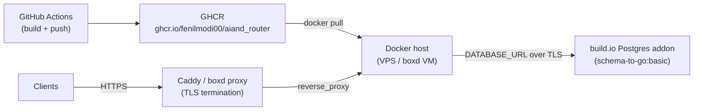

# Container Deployment (Portable Fallback)

This is a fallback plan for releasing the router as a portable container on any
Docker host. It does **not** claim a host has been provisioned or tested; it is
the runbook to use if the build.io builder is blocked.

## When to use this

- The build.io builder is stuck or the build quota is exhausted, so
  `git push buildio main` cannot produce a new release.
- You need a host-agnostic fallback that runs the **same image** build.io would
  run, pointed at the **same `DATABASE_URL`** (the build.io Postgres addon is
  reachable externally).

The image is built once in GitHub Actions, pushed to GHCR, and can then be run
on any Docker host (VPS, boxd VM, bare Docker) without rebuilding.

## Architecture



**Single replica only.** The router image starts an embedded Pub/Sub emulator;
running more than one replica would give you multiple uncoordinated emulators.
Scale horizontally only after moving Pub/Sub out of the container.

## Env file

Generate the env file on a **trusted machine** from the build.io app config,
add `PORT=8080`, and install it with restrictive permissions. Never commit it
and never print its contents.

```sh
bld config -a aiand-router -j | jq -r 'to_entries[] | "\(.key)=\(.value)"' > /etc/aiand-router.env
echo 'PORT=8080' >> /etc/aiand-router.env
chmod 0600 /etc/aiand-router.env
```

The release script passes this file to `docker run --env-file`; it prints the
path, never the contents.

## Registry auth

The fallback host pulls the image from GHCR. The release workflow attempts to
make the package public, because the image contains no secrets. If it stays
private, create a read-only personal access token with the `read:packages`
scope and log in on the host before running the release script:

```sh
echo "$GHCR_READ_TOKEN" | docker login ghcr.io -u <github-user> --password-stdin
```

Never put the token in the env file or in the release script.

## Release

Pin the image by digest so the deployed build is exactly what CI produced:

```sh
scripts/deploy/container_release.sh \
  --image ghcr.io/fenilmodi00/aiand_router@sha256:<digest> \
  --env-file /etc/aiand-router.env
```

Preview without touching Docker:

```sh
scripts/deploy/container_release.sh \
  --image ghcr.io/fenilmodi00/aiand_router@sha256:<digest> \
  --env-file /etc/aiand-router.env --dry-run
```

Defaults: `--name aiand-router --port 8080 --health-path /livez
--health-retries 30 --health-interval 2`.

## TLS / reverse proxy

The script publishes `-p <bind>:<port>:<port>`; the default bind is `127.0.0.1`
(`--bind`), so only a local reverse proxy can reach the container. Pass
`--bind 0.0.0.0` only when the proxy is remote or you have a firewall rule.

The script does **not** configure TLS. Terminate TLS in front of it.

Caddy (custom domain):

```caddy
router.example.com {
    reverse_proxy 127.0.0.1:8080
}
```

boxd VM: expose the port through the platform proxy to get an HTTPS URL:

```sh
boxd machine proxy set-port --vm <name> --port 8080
# -> https://<name>.boxd.sh
```

## Health and rollback

- The script waits for `GET /livez` (up to 30 attempts, 2s apart) before
  declaring success.
- On health failure it prints the last 100 container log lines, removes the
  failed container, and **restarts the previous image** with the same env file,
  port, and name, then exits non-zero.
- Database migrations are idempotent at boot, so a rollback restart is safe.
- Rollback to an even older digest is just a re-run of the release script with
  the old `@sha256:<digest>`.

## Cost comparison

Prices are **estimates** for planning; verify current pricing before deciding.

| Option | Specs | Est. monthly cost | Notes |
|---|---|---|---|
| build.io `performance-m` dyno | current production dyno | **$146/mo** (docs: 8 dyno units × $0.025/h × 730h) | What we run today; builder quota is the pain point |
| build.io `standard-2x` | 1 GB RAM | **$36.50/mo** (2 dyno units) | May be too small for the ONNX embedder |
| build.io `schema-to-go:basic` Postgres | — | **$9/mo** | Kept in every scenario below |
| boxd 1 vCPU / 4 GB always-on | 1×$0.047/h + 4×$0.014/h + 100 GiB×$0.000096/h, 730h | **~$75–82/mo** | Convenient but pricey for 24/7 |
| Hetzner CX22 | 2 vCPU / 4 GB | **~€4.5/mo** (estimate; verify current price) | Cheapest self-managed option |
| Fly.io shared-cpu-2x | 2 GB | **~$10–15/mo** (estimate; verify current price) | Managed, close to build.io ergonomics |

## Recommendation for the first 100 customers

1. **If the account is grandfathered/free, keep the existing build.io dyno.**
   Cheapest zero-migration path; only the *builder* is blocked, not the running
   app.
2. **Preferred unblock:** build the image in GitHub Actions, push to GHCR, and
   use a thin build.io deploy (or ask build.io support to reset the build
   quota). Same platform, same addon, minimal drift.
3. **If build.io cannot unblock:** run the same GHCR image on a cheap
   2 vCPU / 4 GB VPS (Hetzner CX22 or Fly.io) and keep the build.io Postgres
   addon as `DATABASE_URL` — it is reachable externally.
4. **Do not use boxd for 24/7 production**: at published rates its always-on
   cost (~$75–82/mo) is 5–15× a comparable VPS.
5. **After cutover, scale the build.io web dyno to 0** so you are not paying
   double compute.

## Production checklist for the first 100 customers

**Compute**

- [ ] 2 vCPU / 4 GB minimum.
- [ ] Exactly one replica — the image embeds the Pub/Sub emulator.
- [ ] Watch CPU/memory and p95 embed latency.

**Database**

- [ ] Keep the build.io Postgres addon.
- [ ] Enable backups.
- [ ] Confirm `DATABASE_URL` uses TLS.
- [ ] Migrations are idempotent at boot.

**TLS / domain**

- [ ] Managed TLS (Fly/Render) or Caddy + Let's Encrypt.
- [ ] Custom domain configured.
- [ ] HSTS enabled.

**Secrets**

- [ ] Host env file at `0600`, or a platform secret store.
- [ ] Keep `EXTERNAL_KEY_ENCRYPTION_KEY` stable across deploys.
- [ ] Rotate `ROUTER_ADMIN_PASSWORD`.
- [ ] Never bake secrets into the image.

**Observability**

- [ ] JSON logs shipping somewhere durable.
- [ ] `/livez`, `/readyz`, `/startupz` reachable through the proxy.
- [ ] Uptime monitor on the health endpoint.
- [ ] 5xx/latency alerts; DB connection alerts.

**Deploy**

- [ ] GitHub Actions builds and tests before publish.
- [ ] Digest-pinned images (`@sha256:<digest>`).
- [ ] Release script health check + automatic rollback verified once.
- [ ] No per-environment rebuilds — same image everywhere.

**Security**

- [ ] Image scan + SBOM in CI.
- [ ] Firewall: only 80/443/SSH open.
- [ ] Admin endpoints authenticated.
- [ ] Rate limits on public endpoints.

**Cost**

- [ ] Scale the build.io web dyno to 0 after cutover.
- [ ] Keep the GHCR package public.
- [ ] Billing alert on the new host.

**Support**

- [ ] Status page.
- [ ] Incident runbook.
- [ ] Support email published.
- [ ] On-call rotation agreed.
